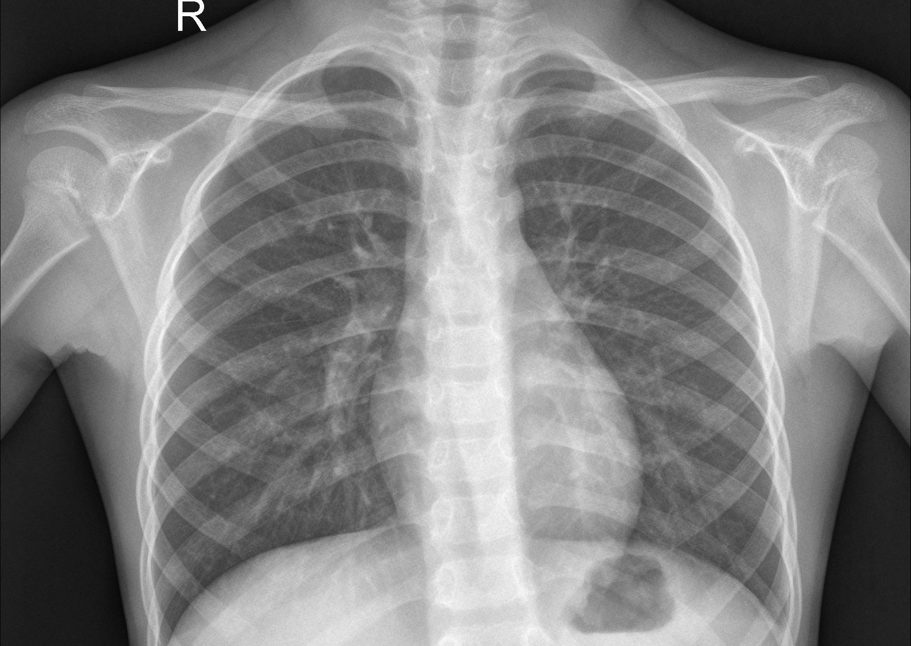
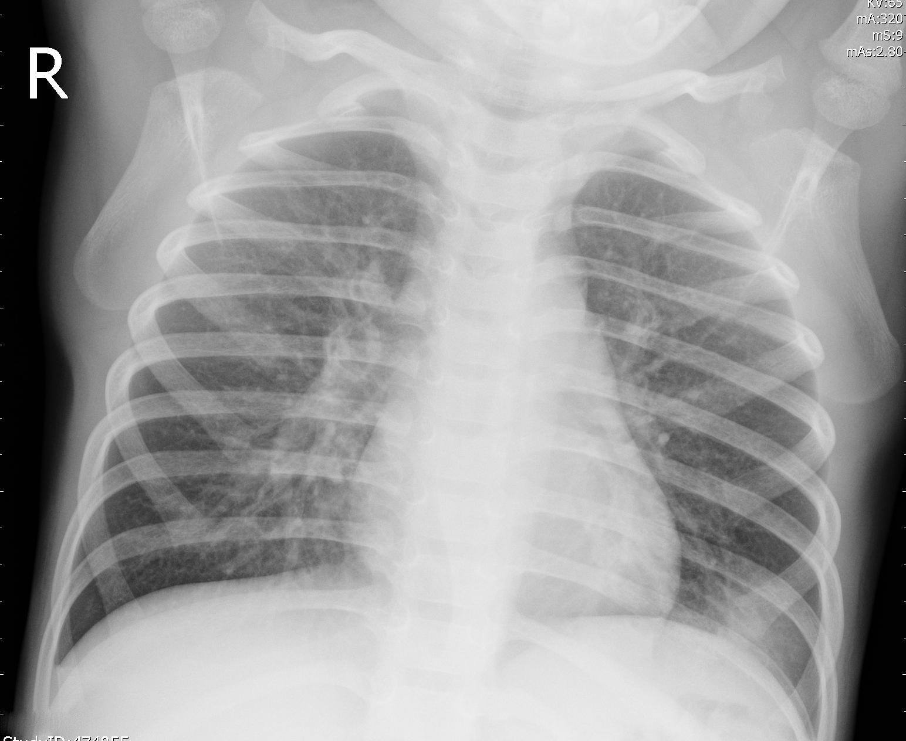
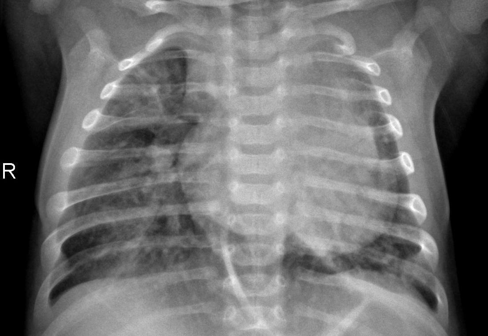
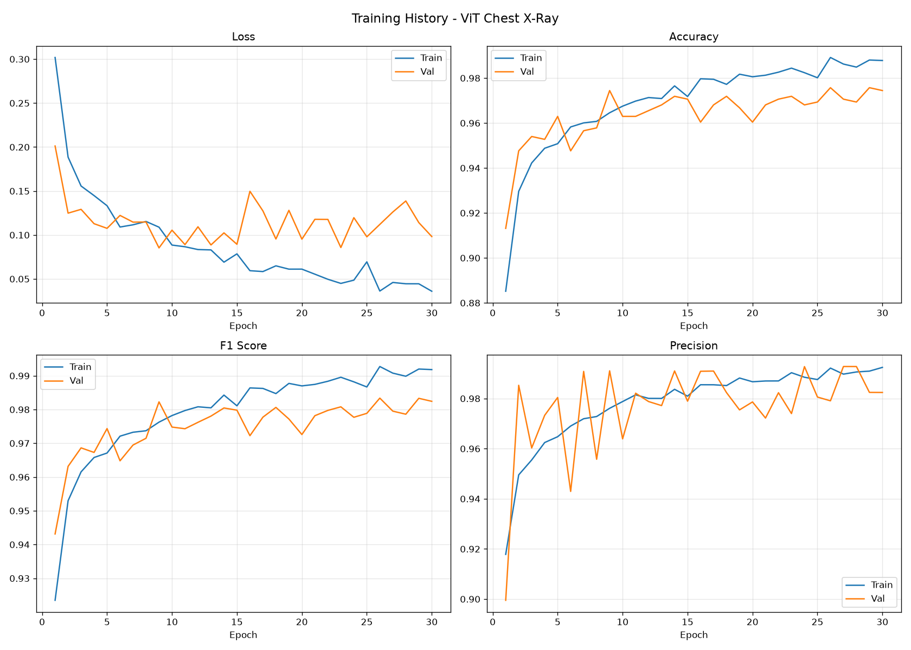

<div align="center">

# 🩻 PneumoVision-ViT

### Chest X-Ray Classification with a PyTorch Vision Transformer

*From image patches to class predictions: train, evaluate, and explore a Vision Transformer through an interactive Streamlit app.*

[](https://www.python.org/)
[](https://pytorch.org/)
[](#-streamlit-application)
[](LICENSE)

**[Live Demo](https://vitpneumovision.streamlit.app/) · [Overview](#-overview) · [Results](#-recorded-results) · [Installation](#-installation) · [Usage](#-usage)**

</div>

---

<div align="center">

### 🌐 Live Demo

**[Try PneumoVision-ViT on Streamlit → vitpneumovision.streamlit.app](https://vitpneumovision.streamlit.app/)**

[](https://vitpneumovision.streamlit.app/)

</div>

---

## ✨ Overview

**PneumoVision-ViT** is a machine-learning project that classifies chest X-ray images into **NORMAL** and **PNEUMONIA** using a custom **Vision Transformer (ViT)** implemented in PyTorch.

The project includes image preprocessing, model training, validation, checkpoint selection, held-out test evaluation, single-image inference, and a **Streamlit interface** for exploring predictions. The model learns from image patches and uses self-attention to combine information across the image.

| 🖼️ Input | 🧠 Model | 📊 Evaluation | 🖥️ Interface |
|:---:|:---:|:---:|:---:|
| Chest X-ray images resized to 288 × 288 | Custom ViT with 4 transformer blocks | Accuracy, precision, recall, F1, and confusion matrix | Image preview, predicted class, and class probabilities |

> **Research and educational use only.** This project is a machine-learning demonstration, not a clinical diagnostic system. Its predictions should not guide medical decisions.

---

## 🚀 Features

- 🩻 Binary classification of chest X-ray images: **NORMAL** or **PNEUMONIA**.
- 🧩 Non-overlapping image patches with learned positional embeddings.
- 🧠 A PyTorch implementation of multi-head self-attention and transformer encoder blocks.
- ⚙️ Central configuration for model settings, preprocessing, paths, and training.
- 📚 A seeded training/validation split with a separate test directory.
- 💾 Checkpoint selection based on validation F1 for the pneumonia class.
- 📈 Saved training history, training curves, and test metrics.
- 🔍 Single-image inference through Python or the command line.
- 🖥️ A Streamlit app with image preview and probability bars.
- 💻 Automatic CUDA selection when available, with CPU fallback.

---

## 📋 Dataset and Classes

The project uses the **[Chest X-Ray Images (Pneumonia) dataset](https://www.kaggle.com/datasets/paultimothymooney/chest-xray-pneumonia)**. Download it separately and place the extracted `chest_xray` directory in the project root. The dataset is excluded from Git.

| Label | Index | Meaning in this project |
|---|:---:|---|
| **NORMAL** | `0` | Images labeled NORMAL in the dataset |
| **PNEUMONIA** | `1` | Images labeled PNEUMONIA; bacterial and viral examples share this class |

The directory counts verified in the local dataset are:

| Directory | NORMAL | PNEUMONIA | Total | Use |
|---|---:|---:|---:|---|
| `chest_xray/train/` | 1,341 | 3,875 | 5,216 | Source for training and internal validation |
| `chest_xray/val/` | 8 | 8 | 16 | Not used by the Python training pipeline |
| `chest_xray/test/` | 234 | 390 | 624 | Held-out test evaluation |

`dataset_utils.py` shuffles the training indices with **seed 123** and allocates **4,433 images to training** and **783 to validation**. This is an image-level random split; it is not stratified or grouped by patient. Test images are not used for training or checkpoint selection.

<div align="center">





*Repository examples, from left to right: NORMAL, viral pneumonia, and bacterial pneumonia. The classifier outputs only the two classes listed above.*

</div>

---

## 🔄 How It Works

```text
Chest X-Ray Image
        │
        ▼
Convert to RGB → Resize to 288 × 288 → Normalize
        │
        ▼
256 Image Patches, each 18 × 18 pixels
        │
        ▼
Linear Projection + Learned Positional Embeddings
        │
        ▼
4 Transformer Encoder Blocks
        │
        ▼
Layer Normalization → Flatten → MLP Classifier
        │
        ▼
Two Logits → Softmax at Inference
        │
        ├── NORMAL probability
        └── PNEUMONIA probability
```

The predicted class is the class with the larger probability. The displayed confidence is that softmax score; it is not a calibrated estimate of diagnostic certainty.

---

## 🏗️ Architecture

### 1️⃣ Image Preprocessing

Training and inference use RGB images resized to **288 × 288**. Tensor conversion scales pixel values to `[0, 1]`, followed by channel normalization:

```python
mean = [0.485, 0.456, 0.406]
std = [0.229, 0.224, 0.225]
```

Training augmentation is available through `config.USE_DATA_AUG`, but is **disabled by default**. Optional transforms include rotation, affine translation, scaling, shear, and configurable flips.

### 2️⃣ Patch Encoding and Attention

`vit_model.py` extracts **256 patches** with `Tensor.unfold`. Each RGB patch contains **972 values** (`18 × 18 × 3`) and is projected into a **16-dimensional embedding**. A learned embedding supplies the patch position.

Each of the four transformer blocks contains:

1. Layer normalization and four-head self-attention.
2. A residual connection.
3. Layer normalization and an MLP with **16 → 32 → 16** dimensions, GELU, and dropout.
4. A second residual connection.

### 3️⃣ Classification Head

The normalized patch sequence is flattened into **4,096 features** and passed through an MLP with **1,024** and **512** units, followed by a two-logit output layer. This implementation uses a flattened patch sequence rather than a separate classification token.

| Setting | Value |
|---|---|
| Input shape | `B × 3 × 288 × 288` |
| Patch size / count | `18 × 18` / `256` |
| Embedding dimension | `16` |
| Transformer blocks / attention heads | `4` / `4` |
| Transformer MLP | `16 → 32 → 16` |
| Classification head | `4096 → 1024 → 512 → 2` |
| Transformer dropout / head dropout | `0.1` / `0.5` |
| Trainable parameters | **4,749,746** |
| Initialization | Trained from scratch; no pretrained backbone is loaded |

---

## 📊 Recorded Results

The following figures come from the repository's saved [test results](results/test_results.json) and [training history](results/training_history.csv). They describe the recorded run, not a new benchmark or a claim of clinical performance.

| Metric | Recorded value |
|---|---:|
| Test images | **624** |
| Test accuracy | **75.64%** |
| PNEUMONIA precision | **72.28%** |
| PNEUMONIA recall | **98.97%** |
| PNEUMONIA F1 | **83.55%** |
| Test cross-entropy loss | **2.52532** |
| Selected checkpoint epoch | **26** |
| Validation accuracy at selected epoch | **97.57%** |
| Validation PNEUMONIA F1 at selected epoch | **98.34%** |

Precision, recall, and F1 use **PNEUMONIA as the positive class**. High pneumonia recall is accompanied by false positives on NORMAL images. The substantial gap between validation and test performance is a key limitation of this run.

<div align="center">



*Saved training and validation curves from the recorded run.*

</div>

---

## 🖥️ Streamlit Application

The app is deployed at **[vitpneumovision.streamlit.app](https://vitpneumovision.streamlit.app/)**, or you can run it locally. The interface lets you:

1. Upload a **JPG, JPEG, or PNG** image.
2. Preview the uploaded X-ray.
3. Run inference automatically after upload.
4. Review the predicted class and both class probabilities.
5. Inspect the checkpoint epoch and saved validation F1.

Launch the app locally from the project root:

```bash
python -m streamlit run app.py
```

The app requires `checkpoints/best_vit.pt`. Inference runs on the machine hosting the app and does not call a cloud model API. Uploaded files are written to `.streamlit_temp/`; the current app does not automatically delete them.

---

## 📁 Project Structure

```text
pneumovision-vit/
├── app.py                          # Streamlit interface
├── config.py                       # Paths and model/training settings
├── dataset_utils.py                # Dataset split, transforms, and loaders
├── vit_model.py                    # Vision Transformer implementation
├── train.py                        # Training and checkpoint selection
├── evaluate.py                     # Held-out test evaluation
├── predict.py                      # Single-image inference and CLI
├── requirements.txt                # Snapshot of the development environment
├── LOCAL_SETUP_NOTES.md             # Historical local setup notes
├── LICENSE                         # Mozilla Public License 2.0
├── .gitattributes                  # Git LFS rule for .pt files
├── .gitignore
├── assets/                         # Example images and earlier experiment figures
├── checkpoints/
│   └── best_vit.pt                  # Saved model checkpoint; tracked with Git LFS
├── results/
│   ├── training_history.csv
│   ├── training_curves.png
│   └── test_results.json
├── notebooks/
│   └── pneumonia_vit_pytorch.ipynb   # Exploratory notebook
└── chest_xray/                     # Download separately; ignored by Git
    ├── train/{NORMAL,PNEUMONIA}/
    ├── val/{NORMAL,PNEUMONIA}/
    └── test/{NORMAL,PNEUMONIA}/
```

---

## ⚙️ Requirements

| Requirement | Details |
|---|---|
| Python | **3.11** is the verified local runtime |
| PyTorch / torchvision | The recorded environment uses **2.6.0 / 0.21.0** |
| Git LFS | Required to retrieve the saved `.pt` checkpoint through Git |
| Hardware | CPU inference is supported; a compatible NVIDIA GPU can accelerate training and inference |
| Dataset | Required for training and evaluation; not required for inference with the saved checkpoint |

The local development environment used Python **3.11.9** and PyTorch **2.6.0+cu124**. `requirements.txt` includes CUDA-specific PyTorch pins and many development packages, so it should not be treated as a portable CPU installation file.

---

## 📦 Installation

### 1. Clone the Repository and Retrieve the Checkpoint

Install [Git LFS](https://git-lfs.com/) if it is not already available, then run:

```bash
git lfs install
git clone https://github.com/ShekhawaTTiku/pneumovision-vit.git
cd pneumovision-vit
git lfs pull
```

### 2. Create a Python 3.11 Environment

**Windows PowerShell:**

```powershell
py -3.11 -m venv .venv
.\.venv\Scripts\Activate.ps1
python -m pip install --upgrade pip
```

**Linux / macOS:**

```bash
python3.11 -m venv .venv
source .venv/bin/activate
python -m pip install --upgrade pip
```

### 3. Install PyTorch for Your Hardware

Choose **one** of the following commands. These version pairs and package indexes follow the [official PyTorch installation instructions](https://pytorch.org/get-started/previous-versions/#v260).

**CPU — Windows / Linux:**

```bash
python -m pip install torch==2.6.0 torchvision==0.21.0 --index-url https://download.pytorch.org/whl/cpu
```

**NVIDIA GPU with a compatible CUDA 12.4 driver — Windows / Linux:**

```bash
python -m pip install torch==2.6.0 torchvision==0.21.0 --index-url https://download.pytorch.org/whl/cu124
```

**macOS:**

```bash
python -m pip install torch==2.6.0 torchvision==0.21.0
```

The current scripts select CUDA or CPU; they do not select Apple's MPS backend.

### 4. Install the Runtime Libraries

```bash
python -m pip install streamlit pillow numpy scikit-learn matplotlib pandas tqdm
```

These are the direct runtime libraries for the app and scripts. Jupyter tooling is optional for notebook exploration. The full `requirements.txt` preserves the original environment snapshot separately.

### 5. Verify the Model and Launch the App

```bash
python vit_model.py
python predict.py --image assets/Bacteria.jpg
python -m streamlit run app.py
```

`vit_model.py` checks the model's forward pass. The prediction command additionally checks that the trained checkpoint can be loaded.

---

## ▶️ Usage

### Single-Image Prediction

```bash
python predict.py --image assets/Bacteria.jpg
```

To select a checkpoint explicitly:

```bash
python predict.py --image assets/Bacteria.jpg --checkpoint checkpoints/best_vit.pt
```

Or call the same function from Python:

```python
from predict import predict

result = predict(
    image_path="assets/Bacteria.jpg",
    checkpoint_path="checkpoints/best_vit.pt",
)
print(result)
```

### Train the Model

Place the dataset in the directory structure shown above and review `config.py` before running:

```bash
python train.py
```

Training saves the selected checkpoint and records epoch metrics under `results/`. A new run can overwrite the existing checkpoint, history, and plots; copy those artifacts elsewhere first if you want to preserve the recorded run.

### Evaluate on the Test Set

```bash
python evaluate.py
```

This prints aggregate metrics, a per-class classification report, and a confusion matrix, then writes `results/test_results.json`. The current loader also initializes the training dataset, so keep both `chest_xray/train/` and `chest_xray/test/` available when evaluating.

<details>
<summary><b>🧪 Optional short training check</b></summary>

```bash
python train.py --sanity
```

This runs three short epochs using five training batches and three validation batches. It does not save a checkpoint, but it does overwrite `results/training_history.csv`. Its loss values use a simplified batch-count denominator and should not be compared with full-run losses.

</details>

---

## 📤 Example Output

The included checkpoint returned the following result for `assets/Bacteria.jpg` using the Python call above:

```json
{
  "predicted_class": "PNEUMONIA",
  "confidence": 1.0,
  "probabilities": {
    "NORMAL": 0.0,
    "PNEUMONIA": 1.0
  },
  "checkpoint_used": "checkpoints/best_vit.pt",
  "checkpoint_epoch": 26,
  "checkpoint_val_f1": "0.9833770778652668"
}
```

Scores are rounded to four decimal places by `predict.py`. A displayed value of `1.0` does not establish certainty or guarantee a correct prediction.

---

## 🎯 Training Configuration and Design Decisions

| Setting | Default in the Python pipeline |
|---|---|
| Loss | Cross-entropy on two logits |
| Optimizer | AdamW |
| Learning rate | `0.001` |
| Weight decay | `0.0001` |
| Batch size | `16` |
| Maximum epochs | `30` |
| Checkpoint selection | Highest validation PNEUMONIA F1 |
| Early stopping | 20 epochs without improvement in validation accuracy |
| Random seed | `123` |
| Training augmentation | Disabled by default |

**Why a custom ViT?** The implementation exposes patch extraction, positional embeddings, attention, and the classification head directly, making the architecture accessible for experiments.

**Why an internal validation split?** The supplied validation directory has only 16 images. Reserving part of the training directory provides a larger validation set while preserving the separate test directory.

**Why report several metrics?** The dataset has more pneumonia than normal images, and the recorded model has high recall with lower precision. Accuracy or recall alone would give an incomplete picture.

**Why shared Python modules?** The Streamlit app calls `predict.py`, which loads the model from `vit_model.py`. The app and command-line interface therefore use the same inference implementation.

---

## ⚠️ Limitations

| Area | Current limitation |
|---|---|
| Generalization | Recorded validation performance is substantially higher than held-out test performance. No external clinical validation is provided. |
| False positives | High pneumonia recall accompanies lower precision and errors on NORMAL images. |
| Split strategy | Training/validation splitting is image-level, without stratification or explicit patient grouping. |
| Class imbalance | Training uses unweighted cross-entropy; there is no class-weighted loss or balanced sampler. |
| Confidence | Softmax scores are not calibrated; the app does not reject uncertain or unrelated images. |
| Supported inputs | The app accepts JPG, JPEG, and PNG; it does not implement DICOM handling or disease localization. |
| Notebook consistency | Some notebook cells reference settings or constructor arguments that differ from the current scripts. Use the Python scripts as the reference workflow. |
| Saved configuration | Only part of the model configuration is stored in the checkpoint; changing architecture or preprocessing settings requires care when loading older weights. |
| App behavior | The model is loaded again for each prediction, uploaded files remain in `.streamlit_temp/`, and sidebar performance figures are hard-coded. |

---

## 🛣️ Future Improvements

- 📊 Add patient-aware splits, stratification, and evaluation on additional datasets.
- ⚖️ Compare class weighting and balanced sampling to reduce false positives.
- 🎚️ Study probability calibration and select decision thresholds using validation data.
- 🧠 Compare the custom model with pretrained ViTs and CNN baselines under the same evaluation protocol.
- 🧹 Evaluate appropriate augmentation and image preprocessing systematically.
- 🔍 Add model interpretation visualizations and investigate failure cases.
- 📈 Save confusion-matrix plots, ROC/precision-recall curves, and per-image predictions.
- 🖥️ Cache the model in Streamlit, clean up uploads, and read displayed metrics from result files.
- 📓 Bring the notebook into agreement with the Python pipeline.
- 📦 Separate portable runtime requirements from development and GPU-specific dependencies.

---

## 🛠️ Technologies Used

| Technology | Purpose |
|---|---|
| **Python** | Training, evaluation, inference, and application code |
| **PyTorch** | Model layers, optimization, tensors, and checkpoints |
| **torchvision** | ImageFolder datasets and image transformations |
| **Streamlit** | Interactive browser interface |
| **Pillow** | Image loading and RGB conversion |
| **NumPy** | Numerical operations and prediction arrays |
| **scikit-learn** | Accuracy, F1, precision, recall, reports, and confusion matrix |
| **Matplotlib** | Training curves and exploratory visualizations |
| **pandas** | Notebook analysis of saved training history |
| **tqdm** | Training and evaluation progress bars |
| **Git LFS** | Versioning the saved model checkpoint |

---

## 📚 References and Acknowledgments

- [Chest X-Ray Images (Pneumonia) dataset](https://www.kaggle.com/datasets/paultimothymooney/chest-xray-pneumonia).
- [Keras: Image classification with Vision Transformer](https://keras.io/examples/vision/image_classification_with_vision_transformer/), an architecture reference for the earlier TensorFlow/Keras approach described in the project source.
- [PyTorch installation guidance](https://pytorch.org/get-started/previous-versions/).

The Python implementation adapts the earlier TensorFlow/Keras design to PyTorch. It uses consistent image normalization and PyTorch's attention convention, where the 16-dimensional embedding is divided across four heads. Results from earlier implementations or experiment figures should not be interpreted as measurements of this saved PyTorch checkpoint.

---

## 👤 Maintainer

**Digvijay Singh Shekhawat**

[](https://github.com/ShekhawaTTiku)

---

## 📜 License

This repository includes the **Mozilla Public License 2.0**. See [LICENSE](LICENSE) for the full text. Refer to the dataset source for its separate terms.

---

<div align="center">

*Built with 🐍 Python, 🔥 PyTorch, and 🖥️ Streamlit.*

</div>
